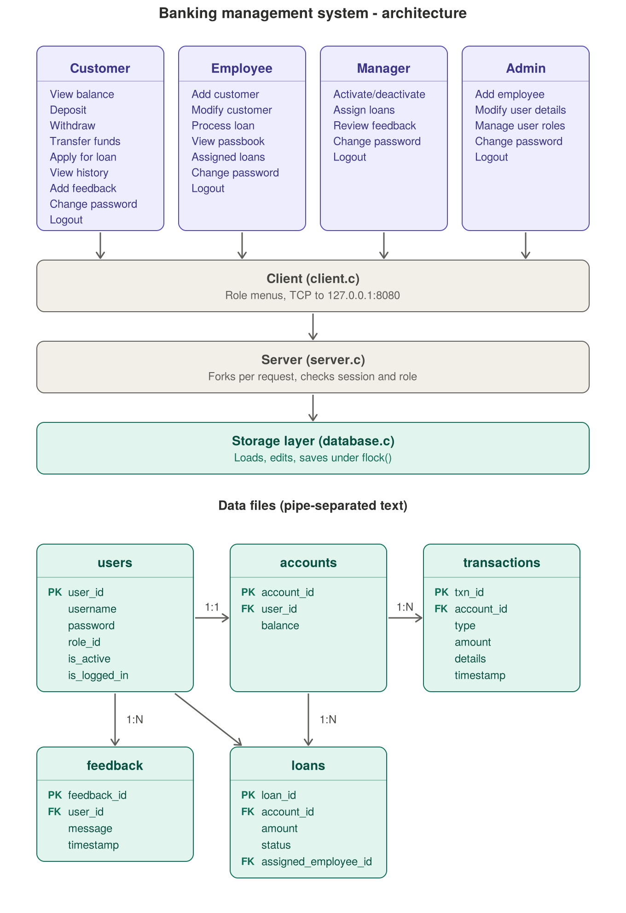

# Banking Management System

A C-based banking application with a multi-role client/server design. It includes a socket-based server, a console client, and a flat-file data layer for persistent banking records.



## Overview

This project simulates a small banking ecosystem with separate access levels for:

- Customers
- Bank Employees
- Managers
- Administrators

The server accepts requests over TCP sockets, validates session access, and updates a local file-based datastore.

## Key Features

### Customer features
- Create a new customer account
- Log in and log out
- View account balance
- Deposit money
- Withdraw money
- Transfer funds to another account
- View transaction history
- Apply for a loan
- Submit feedback
- Change password

### Employee features
- Add new customer accounts
- Modify customer passwords
- View a customer's passbook
- Review assigned loan applications
- Process loan requests as approved or rejected
- Change personal password

### Manager features
- Activate or deactivate customer accounts
- View pending and assigned loan applications
- Assign loan applications to employees
- Review customer feedback
- Change password

### Administrator features
- Add employees
- Modify user details
- Manage user roles
- Change password

## Project Structure

- `server.c` — main TCP server, business logic, request routing, and role-based handling
- `client.c` — interactive console client used to log in and access banking operations
- `database.c` — flat-file storage layer that loads and saves user, account, transaction, loan, and feedback data
- `banking_architecture.png` — architecture diagram for the system

## Data Storage

The server uses flat text files created in the same directory where the program is run:

- `users.txt` — user records
- `accounts.txt` — account records
- `transactions.txt` — transaction records
- `loans.txt` — loan records
- `feedback.txt` — customer feedback
- `bank.lock` — file lock used to prevent concurrent writes

This is not a production database; it is a lightweight local persistence model designed for learning and demonstration.

## Default Seed Data

On first run, the application creates sample users automatically:

| Role | Username | Password | User ID |
| --- | --- | --- | --- |
| Customer | `cust1` | `pass` | `101` |
| Customer | `cust2` | `pass2` | `102` |
| Employee | `emp1` | `pass` | `201` |
| Manager | `mgr1` | `pass` | `301` |
| Administrator | `admin1` | `pass` | `401` |

## Build Instructions

From the project root:

```bash
gcc server.c -o server
gcc client.c -o client
```

## Run Instructions

Start the server in one terminal:

```bash
./server
```

Then start the client in another terminal:

```bash
./client
```

The client will prompt you to choose a role and log in. The server listens on port `8080`.

## Example Workflow

1. Start the server.
2. Run the client.
3. Select a role such as `Customer` or `Administrator`.
4. Log in using one of the seeded credentials.
5. Use the menu to perform the corresponding actions.

## Notes

- The server uses `fork()` to handle each client connection in a child process.
- Session validity is enforced through `is_logged_in` flags and role checks.
- The design is intentionally simple and educational rather than enterprise-ready.

## License

This project is provided as a learning/demo banking system. No explicit license is included in the repository.
